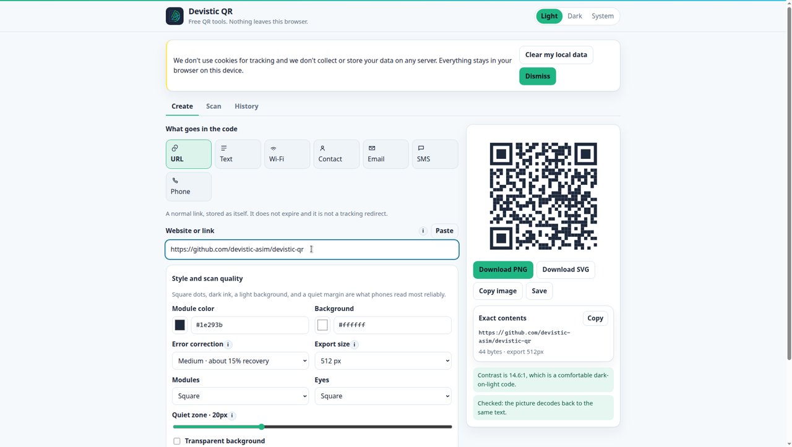
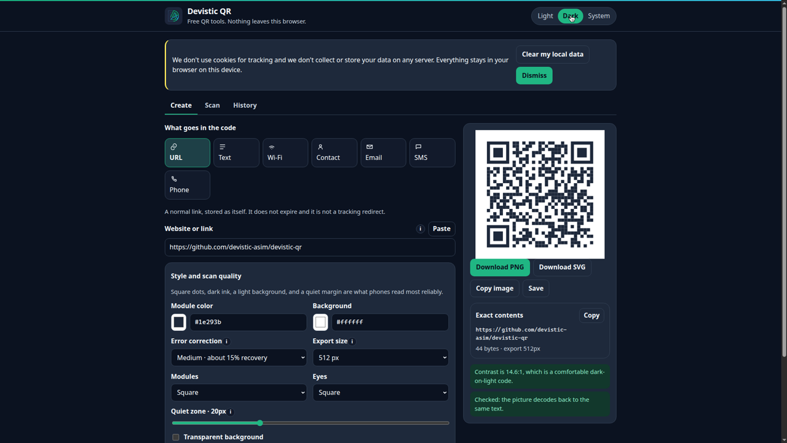
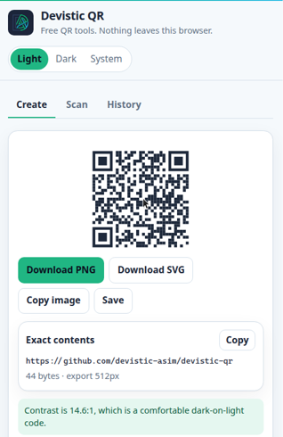
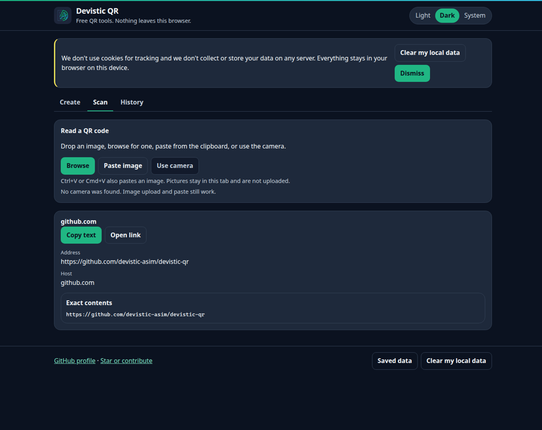

# Devistic QR

A free, one-page QR code generator and reader. It runs entirely in your browser: no account, no analytics, and no server copy of what you type or scan.

**Live:** [https://devistic-asim.github.io/devistic-qr/](https://devistic-asim.github.io/devistic-qr/)









## Features

- Text, URL, Wi-Fi, vCard contact, email, SMS, and phone presets, with a live preview
- Error correction, size, quiet zone, colors, module shape, and an optional center logo
- Download PNG or SVG, and copy the QR image
- Read a code from an upload, a drag-and-drop, a clipboard paste (`Ctrl+V` / `Cmd+V` or the Paste button), or the camera
- One-click copy of decoded text, with links shown before they open
- Local history with search, delete, and clear
- Import and export history as JSON (codes, settings, and theme) or CSV
- Light, dark, and system themes, set before the page paints

The best public tools in this category show the exact static payload, warn when contrast or a logo will hurt a scan, and do not turn a code into a tracking redirect. Devistic QR follows that: the string under the preview is the string inside the code, and a browser decode check confirms the picture reads back.

## How to use

**Create.** Pick a preset, fill in the fields, and the code updates as you type. Download PNG for screens and SVG for print. Paste text into a field, or paste anywhere on the page when a field is not focused.

**Scan.** Drop an image, browse, paste an image, or start the camera. Copy the text, or open a link after you have checked the address. The page does not navigate on its own.

**History.** Codes you download, copy, or scan are kept in this browser. Search them, load one back into the editor, or take a JSON backup with you. CSV is the spreadsheet view of the list.

## Tech stack

- [Vite](https://vite.dev/), [React](https://react.dev/), and TypeScript
- [qr-code-styling](https://github.com/kozakdenys/qr-code-styling) to draw the code, including a center logo
- [jsQR](https://github.com/cozmo/jsQR) and [qr-scanner](https://github.com/nimiq/qr-scanner) to read still images and the camera
- Vitest for the payload, parser, history, and import/export logic
- GitHub Actions for lint, tests, and GitHub Pages

## Run locally

```bash
npm install
npm run dev
```

Open [http://localhost:5173/devistic-qr/](http://localhost:5173/devistic-qr/). The base path matches GitHub Pages.

```bash
npm test
npm run lint
npm run build
npm run preview
```

## Privacy

We don't use cookies for tracking and we don't collect or store your data on any server. Everything stays in your browser on this device.

Drafts, history, the theme, and whether you dismissed the notice are stored in `localStorage` under keys beginning with `devistic-qr`. A logo image is kept for the current visit only. **Clear my local data** removes those keys. A JSON export is the way to move them to another browser.

## Contributing

See [CONTRIBUTING.md](CONTRIBUTING.md) and the [Code of Conduct](CODE_OF_CONDUCT.md).

## License

[MIT](LICENSE) © devistic-asim

## Contact

[github.com/devistic-asim](https://github.com/devistic-asim)
